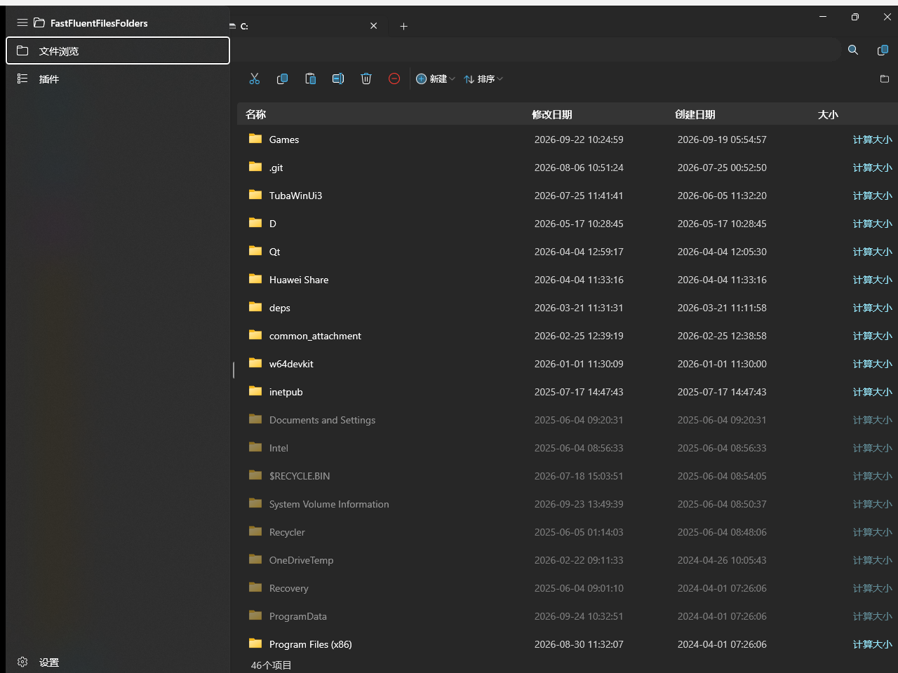
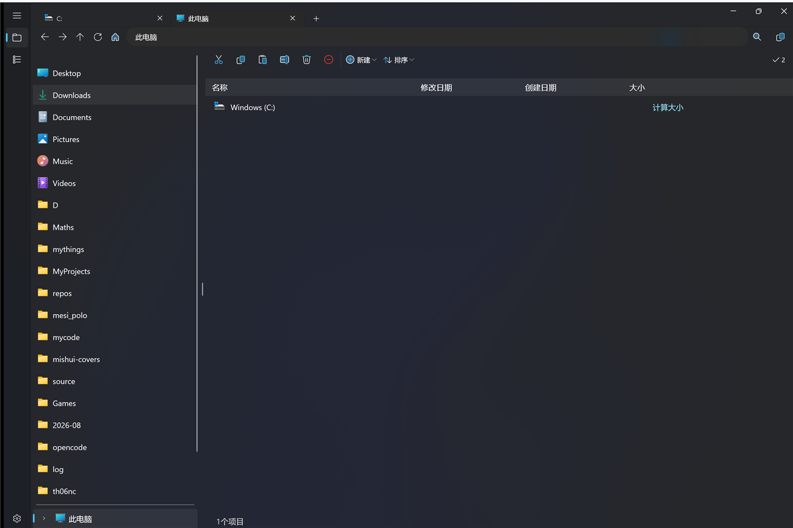
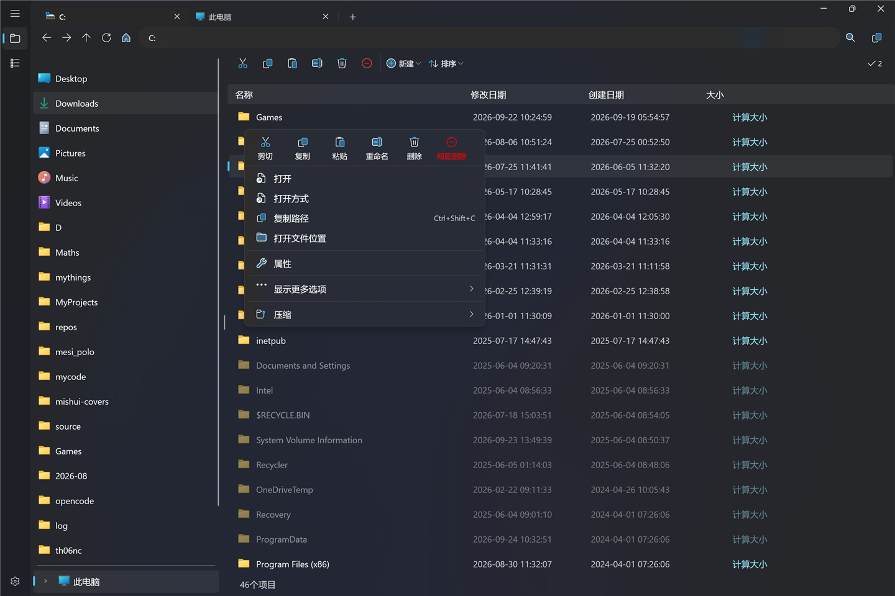
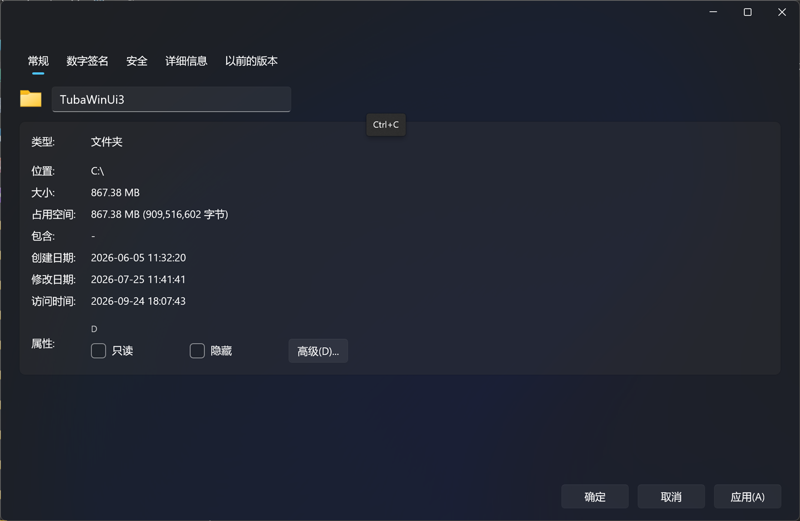
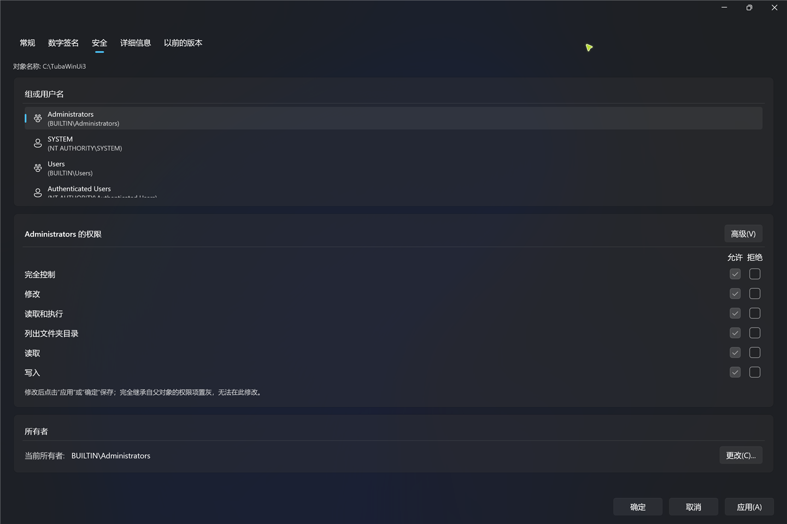
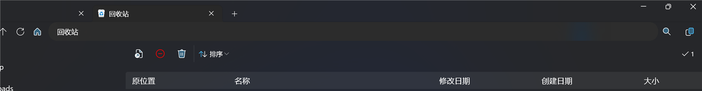
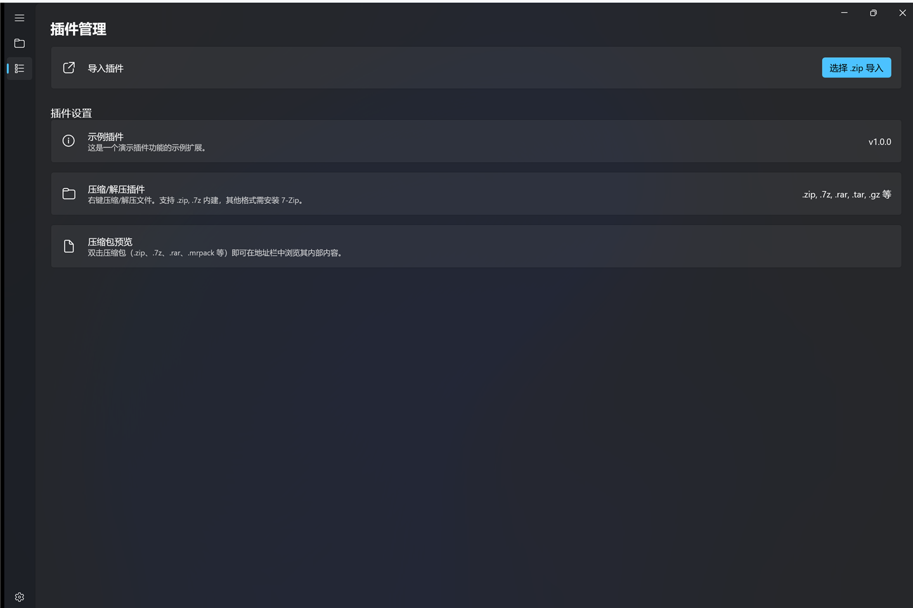

# FastFluentFilesFolders (FFFF)

*它曾经叫 LRS (LiveRootStorage)。*

[English](README.md) | 中文

基于 WinUI 3 和 Windows App SDK 构建的新一代 Windows 文件资源管理器。

[](https://www.gnu.org/licenses/gpl-3.0)
[](https://dotnet.microsoft.com/)
[](https://www.microsoft.com/windows)
[](https://learn.microsoft.com/windows/apps/winui/winui3/)



## 咱想要 star
喜欢的话，就给个 Star 吧⭐~

## 安装提示（适用于 v1.0.0-beta 之前的版本）
在v1.0.0-beta之前，本软件是自签名的，所以你的电脑可能不信任这个安装包。  
若想让安装包受信任，可以下载并安装我的[证书](https://www.mishui.city/upload/CertForLRS.cer)。  
然后执行这条 PowerShell 命令：  
*'<' 和 '>' 括起来的内容需根据实际情况替换*
`Import-Certificate -FilePath "<你下载的证书文件路径>" -CertStoreLocation "Cert:\CurrentUser\TrustedPeople"`

自 v1.1.0 起程序会就地自动更新（见 [自动更新](#自动更新)）；v1.0.1 及更早的版本没有该功能。

## 功能特性

### 浏览

- **标签页** -- `Ctrl+T` 新建标签页、`Ctrl+W` 关闭标签页，标签页可拖拽排序；每个标签页各自维护前进/后退历史、排序状态与搜索状态
- **文件树侧边栏** -- 以可折叠的树浏览所有位置，子目录按需懒加载，行高 40 px
- **Windows Shell 位置** -- 树从**此电脑**开始（所有磁盘，U 盘/光盘插拔实时跟随），另有**网络**、**Linux（WSL）**（经 Shell 命名空间枚举发行版，自动选用 `\\wsl$` / `\\wsl.localhost`）、**回收站**与**云盘**（OneDrive 个人/企业、Dropbox、Google Drive、iCloud Drive、坚果云、MEGA、百度网盘，自动检测，检测不到就隐藏）
- **面包屑 + 地址栏** -- 自带前进/后退/向上历史，地址栏可编辑且支持相对路径（如 `..\新建文件夹`），子文件夹弹出菜单，面包屑内搜索（`Esc` 退出搜索、恢复普通导航）
- **快速访问** -- 侧栏显示固定文件夹；右键文件夹（或按 `Ctrl+P`）即可在 Windows 快速访问里固定/取消固定，侧栏立刻刷新，资源管理器看到的也是同一批固定项
- **搜索** -- 结果直接显示在同一张表格里，多出一列只读的**位置**
- **按时间分组** -- 对选定的文件夹按时间段（今天、昨天、本周……）分组，参与分组的文件夹列表可在设置里配置
- **目录始终在文件上方** -- 手动排序时，无论升序还是降序、列表视图还是分组视图，文件夹都排在文件上面

### 文件操作

- **剪贴板集成** -- 经 Windows 剪贴板剪切/复制/粘贴；遇到同名项弹一次冲突确认框（替换 / 跳过 / 保留两者）并应用于整批；复制会自动改名，批内不会重名
- **移动与复制引擎** -- 跨盘移动退化为“先复制、再删源”；同名目录的“替换”执行递归合并；把文件夹移动/复制到自身或其子目录会明确报错
- **删除** -- `Delete` 送进回收站，`Ctrl+Delete` 彻底删除；与右键菜单、工具栏共用同一条代码路径
- **回收站** -- 可在应用内浏览（带**原位置**列），支持还原、彻底删除、清空整个回收站（进入回收站会自动切换出专属工具栏）
- **操作岛** -- 每批文件操作逐项显示状态卡片，按真实磁盘结果推进，失败项保留下来可重试，并显示具体错误原因
- **增量刷新** -- 新建/删除/粘贴产生的行就地插入或移除，操作完列表不再跳回顶部（分组与非分组文件夹一致）
- **行内重命名** -- 点击名称原地编辑，`Enter` 确认、`Esc` 取消
- **新建项目** -- 文件夹、文本文档、快捷方式、Excel/Word/PowerPoint 文档，可从工具栏或空白处右键创建
- **复制路径** -- `Ctrl+Shift+C` 复制选中项的完整路径，面包屑与右键菜单里也有
- **属性** -- 完整的 MVVM 属性窗口（见下）
- **插件** -- 用扩展扩充功能；默认自带压缩包（zip/7z）插件，可浏览、压缩、解压、预览

### 属性窗口

- 选项卡：**常规**、**数字签名**、**安全**、**详细信息**、**以前的版本**，可执行文件额外有**兼容性**
- 常规：文件名与描述可编辑，只读/存档/索引属性，后台计算逻辑**大小**与**占用空间**（磁盘分配大小），并列出正在使用该文件的进程
- 数字签名：区分内嵌签名与目录签名，显示签名者、摘要算法与真实时间戳（PKCS#7 / RFC3161）
- 安全：按主体展示允许/拒绝权限矩阵，可直接编辑 ACL，高级对话框可逐条查看 ACE，并支持**更改所有者**（自动经 UAC 提权并启用 `SeTakeOwnership` / `SeRestore`）；修改受保护的系统资源前会先弹确认
- 兼容性（仅 `.exe`）：兼容模式、以管理员身份运行、256 色、640x480、禁用全屏优化、注册以重新启动、高 DPI 缩放——同时写入 64 位与 32 位注册表视图，资源管理器能读到（未打包模式有效；打包模式下会给出提示）
- 以前的版本：查询卷影副本并提供打开 / 还原

### 外观与动画

- **ThemedIcon 矢量图标** -- 整个界面（工具栏、右键菜单、面包屑、操作岛）都用双层矢量轮廓渲染，跟随主题、强调色与禁用态，不依赖字体渲染
- **系统背景材质** -- 默认 Mica，与标题栏一体的 Windows 11 材质
- **切换动画** -- 进入文件夹与刷新有四种模式：**默认**（每行短距离上滑 + 淡入）、**溪流**（逐行错开淡入）、**淡入**（整表淡入）、**关闭**（完全无动画）；前三种模式下新增/删除的行也有动画
- **隐藏与系统项** -- 在目录树和表格里都以 50% 不透明度显示
- **多语言** -- 简体中文与英文，运行时切换无需重启；设置页、下拉框、列头、工具栏与右键菜单立即跟随

## 环境要求

- Windows 10 版本 19041 (20H1) 或更高 / Windows 11
- [.NET 10.0 SDK](https://dotnet.microsoft.com/download/dotnet/10.0)

## 构建与运行

```powershell
dotnet build FastFluentFilesFolders/FastFluentFilesFolders.csproj -c Release -p:Platform=x64
dotnet run --project FastFluentFilesFolders
```

验证时请用上面这条命令：裸跑 `dotnet build` 可能落到另一个输出目录。
Release 产物在 `FastFluentFilesFolders/bin/x64/Release/net10.0-windows10.0.19041.0/`。

提供两种启动配置：

- **FastFluentFilesFolders (Package)** -- 打包（MSIX）部署
- **FastFluentFilesFolders (Unpackaged)** -- 未打包模式，直接运行

### Native AOT（实验性）

```powershell
dotnet publish -c Release -r win-x64 --self-contained true `
  -p:PublishSingleFile=false -p:WindowsPackageType=None `
  -p:PublishAot=true -p:PlatformTarget=x64
```

**不要**往工程文件里加 `<PublishAot>`，也**不要**传 `-p:PublishTrimmed=false`：`PublishAot` 本身就隐含裁剪；而且在普通 `build` 里打开它会让 `runtimeconfig.json` 关闭内置 COM 互操作，于是所有 `{Binding}` 都会静默失效。
`tools/check-aot.ps1` 会真的跑一遍 AOT publish，统计还剩多少 AOT 不安全的代码点（项目代码 / 依赖库分别统计）并给出退出码，所以“现在能不能 AOT 发布”是一条命令，而不是靠人记。

**现状：** AOT 产物能启动、能新建/关闭标签页、Shell 图标也正常，但门禁仍报约 350 条警告（项目代码约 131 条，WinUI/WindowsAppSDK/CommunityToolkit 约 219 条），因此 AOT 仅供实验——日常请用普通 Release 版本。

## 架构

FFFF 遵循 **MVVM** 模式，使用 `CommunityToolkit.Mvvm` 源代码生成器。

| 层级 | 技术 |
|-------|------|
| UI | WinUI 3 / Windows App SDK 2.5，基于 .NET 10 |
| ViewModel | `[ObservableProperty]`（partial 属性）、`[RelayCommand]` 源代码生成器 |
| 依赖注入 | `Microsoft.Extensions.DependencyInjection`，服务在 `App` 中注册 |
| 表格 | `WinUI.TableView`（仓库内工程 `WinUI.TableView/`），由 `LrsTableView` 包装 |
| 图标 | Win32 `SHGetFileInfo`（Shell 命名空间走 PIDL）/ `IShellItemImageFactory` / WinRT `StorageFile.GetThumbnailAsync()` |
| 配置 | JSON + `IChangeToken` 实时重载，使用 `Configuration.Binder` 源生成器 |
| 更新 | NetSparkle + Ed25519 签名的 appcast |

条目模板里使用 `{Binding}` 而不是 `{x:Bind}`，并且所有被 XAML 绑定的类型/属性都按 WinRT 源生成器的要求做了标注，因此在裁剪与 AOT 互操作规则下绑定依然可用。

### 核心组件

| 组件 | 路径 |
|------|------|
| 应用入口 / 依赖注入 | `FastFluentFilesFolders/App.xaml.cs` |
| 主 ViewModel | `FastFluentFilesFolders/ViewModels/MainWindowViewModel.cs` |
| 浏览页 / 标签页 | `FastFluentFilesFolders/Views/ExplorerPage.xaml` |
| 文件树 | `FastFluentFilesFolders/Views/FileTreeView.xaml` |
| 文件列表 | `FastFluentFilesFolders/Views/MiddleFilesView.xaml` |
| 面包屑栏 | `FastFluentFilesFolders/Views/TopView.xaml` |
| 自定义面包屑控件 | `FastFluentFilesFolders/UserControls/LRSBreadcrumb.xaml` |
| 表格包装 | `FastFluentFilesFolders/UserControls/LrsTableView.cs` |
| ThemedIcon 图标 | `FastFluentFilesFolders/UserControls/ThemedIcon.xaml`、`UserControls/IconLibrary.cs` |
| Shell 位置 / 快速访问 | `FastFluentFilesFolders/Services/ShellLocations.cs`、`QuickAccessHelper.cs`、`ShellQuickAccess.cs` |
| 文件操作 | `FastFluentFilesFolders/Services/FileOperator.cs`、`FileOperationReporter.cs` |
| 插件 | `FastFluentFilesFolders/Extensions/`（[开发文档](FastFluentFilesFolders/Extensions/PLUGIN_DEV_GUIDE_ZH.md)） |
| 自动更新 | `FastFluentFilesFolders/Services/AutoUpdateService.cs` |
| 设置页面 | `FastFluentFilesFolders/Views/SettingsView.xaml` |
| 配置 | `FastFluentFilesFolders/ViewModels/Configs.cs` |
| AOT 门禁 | `tools/check-aot.ps1` |

## 配置

运行时配置存储在 `%LocalAppData%\FastFluentFilesFolders\user_configs.json`；默认值在 `FastFluentFilesFolders/Configs/configs.json`。
该文件被监听并实时重载，具体路径也会显示在设置页里。

可配置项（通过设置面板修改）：

| 设置项 | 默认值 |
|--------|--------|
| 首页路径 | `%USERPROFILE%\Downloads` |
| 语言 | `zh-Hans` |
| 默认排序方式 | 修改日期（降序） |
| 行高 | 40 px |
| 系统背景材质 | Mica |
| 切换动画 | 淡入 |
| Win32 图标 API | 开启 |
| 图标并行加载数 | `0` = 自动（安全并发上限 16） |
| 按时间分组文件夹 | 空列表 |

上次使用的排序列与方向也会持久化，所以重启后重新打开的标签页仍保持之前的排序。

## 快捷键

| 快捷键 | 作用 |
|--------|------|
| `Ctrl+T` / `Ctrl+W` | 新建标签页 / 关闭标签页 |
| `Ctrl+P` | 把选中文件夹固定到 Windows 快速访问，或从中取消固定 |
| `Ctrl+Shift+C` | 复制选中项的完整路径 |
| `Ctrl+C` / `Ctrl+X` / `Ctrl+V` | 复制 / 剪切 / 粘贴 |
| `Delete` / `Ctrl+Delete` | 送进回收站 / 彻底删除 |
| `F2` | 重命名选中项 |
| `Enter` / `Alt+Enter` | 打开选中项 / 查看属性 |
| `Enter` / `Esc` | 确认 / 取消行内重命名或地址栏编辑 |

## 自动更新

设置页有一张**检查更新**卡片，点击后打开自绘更新弹窗：当前版本与最新版本、更新内容、下载进度、“跳过此版本”、“立即安装并重启”。
更新会用 Ed25519 签名的 appcast 校验；NetSparkle 的内部日志写在 `%LocalAppData%\FastFluentFilesFolders\update.log`。

## 截图

| | |
|---|---|
|  |  |
|  |  |
|  |  |

## 性能

- **又快又流畅** -- 成百上千项的目录加载起来看不出延迟：枚举与子项实例化异步分两阶段完成，变化的元数据原地更新，前 160 个图标在后台解码进缓存
- **回访文件夹几乎零成本** -- 最近离开的那个文件夹（≤ 5000 项、保鲜 8 秒）会留在热缓存里，A↔B 来回切换直接复用已有节点：实测分配从约 3 MB / 31-47 ms 降到 1.6 MB / 15-16 ms，而主动刷新永远重新读盘
- **不做冗余重建** -- 每次导航只构建一遍表格内容（单遍排好序的快照），输入没变时整段跳过；导航时也不再强制重建行容器，每次导航的 UI 线程占用中位数从 771 ms 降到 169 ms（约 4.5 倍）
- **内存平稳** -- 只为视口内的行实体化容器（`ItemsStackPanel.CacheLength=0`）；连续刷新 20 次加来回切换文件夹 20 次后，进程稳定在约 304 MB 工作集 / 190 MB 私有字节，不再单调上涨
- **切换语言很便宜** -- 约 150 条文案通知会合并成工具栏、右键菜单、列头与分组名各刷新一次（以前每次切换会临时分配约 46 MB，并卡上数秒）
- **对 AOT 友好** -- `[ObservableProperty]` 一律用 partial 属性，被绑定的模型带 `[WinRT.GeneratedBindableCustomProperty]`，转换器标了 `partial`，`TabView` 改为显式维护 `TabItems` 而不是 `ItemsSource`；宣称 AOT 就绪之前请先跑 `tools/check-aot.ps1`

## 许可证

FFFF 采用 [GNU General Public License v3.0](LICENSE.txt) 许可。

版权所有 (C) 2025~2026

本程序为自由软件：您可以依据自由软件基金会发布的 GNU 通用公共许可证条款，将其重新分发和/或修改，无论是许可证的第 3 版还是（由您选择）任何更高版本。
