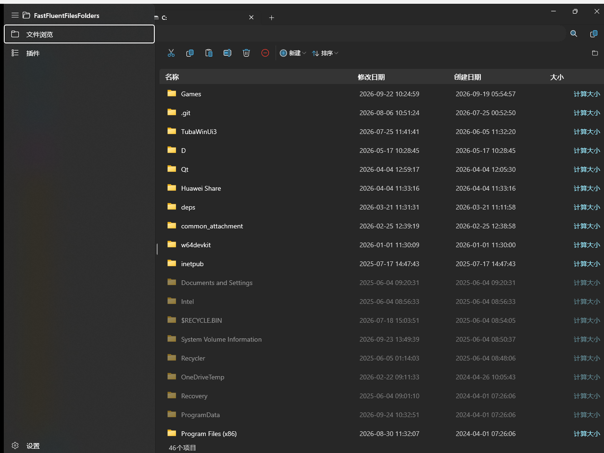
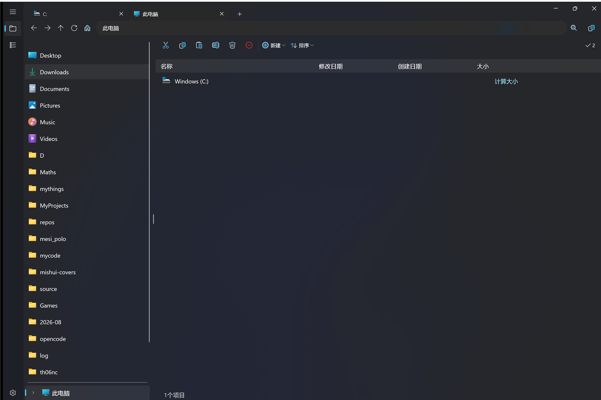
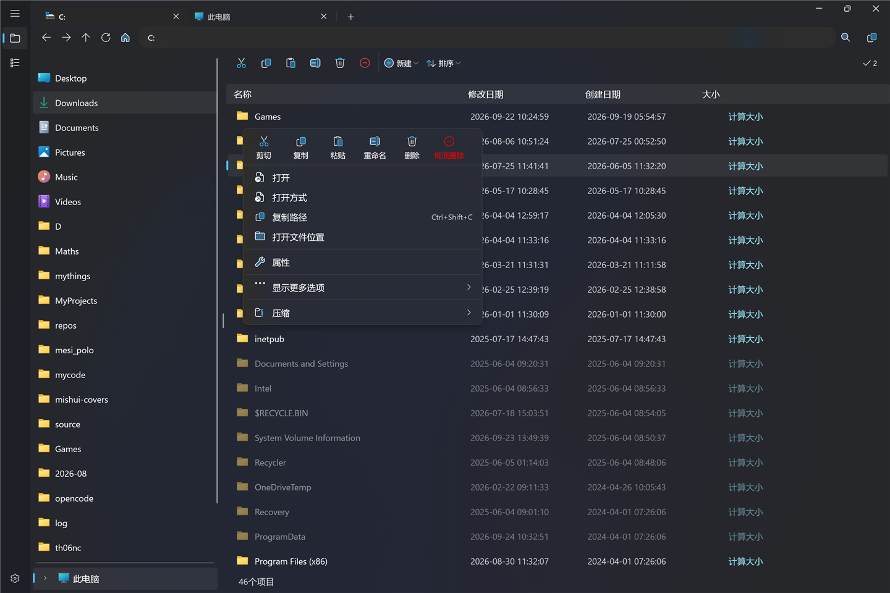
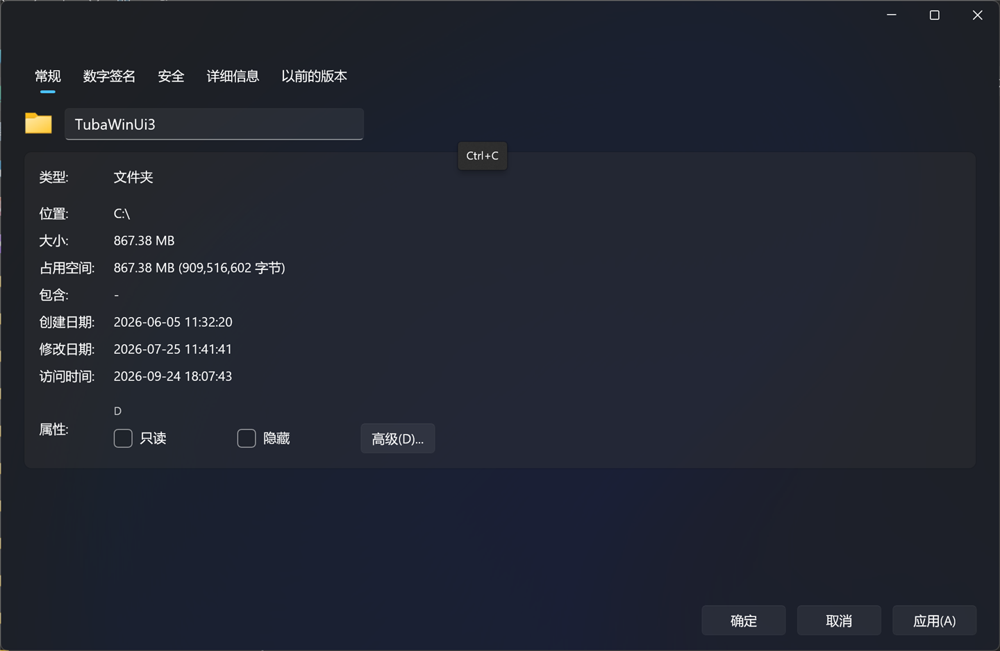
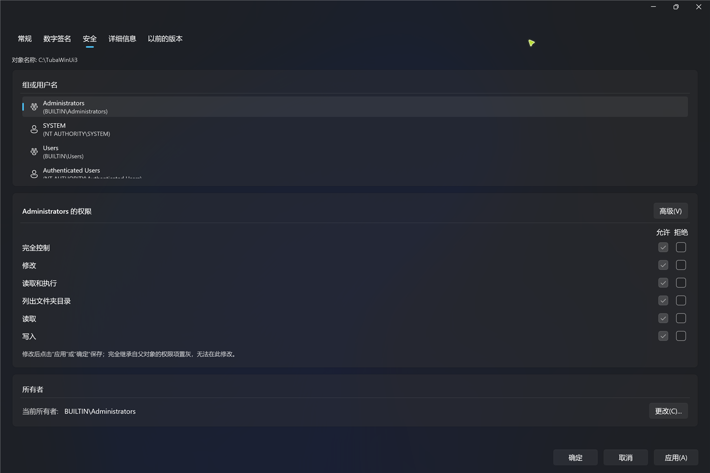
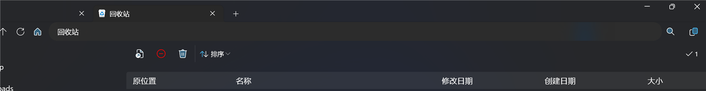
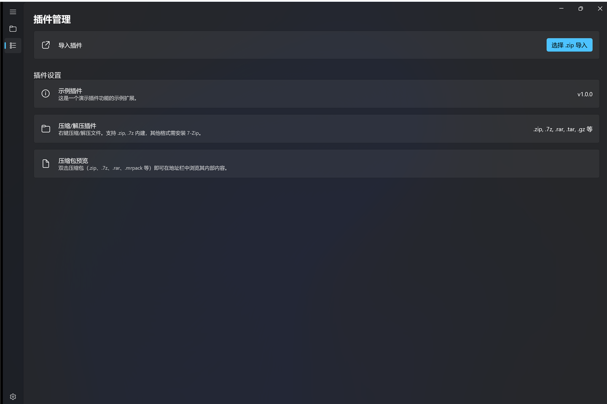

# FastFluentFilesFolders (FFFF)

*This project used to be called LRS (LiveRootStorage).*

English | [中文](README-zh.md)

A modern file explorer for Windows, built with WinUI 3 and the Windows App SDK.

[](https://www.gnu.org/licenses/gpl-3.0)
[](https://dotnet.microsoft.com/)
[](https://www.microsoft.com/windows)
[](https://learn.microsoft.com/windows/apps/winui/winui3/)



## I want a starrrrrrrrrrr
If you like it, please give me a starrrrr⭐, thank youuuuuuuuuu DA⭐ZE!!!

## Install TIP (For releases under v1.0.0-beta!!)
Because this software is self-signed, so your computer may not trust this installer.  
If you want to make the installer trusted, you can download and install my [certification](https://www.mishui.city/upload/CertForLRS.cer).  
Then, you can run this powershell command:  
*The content enclosed in '<' and '>' needs to be replaced according to the actual situation.*
`Import-Certificate -FilePath "<Your certification file path>" -CertStoreLocation "Cert:\CurrentUser\TrustedPeople"`

Since v1.1.0 the app updates itself in place (see [Auto-update](#auto-update)); versions up to v1.0.1 cannot.

## Features

### Browsing

- **Tabs** -- `Ctrl+T` opens a new tab, `Ctrl+W` closes one, tabs can be dragged to reorder; every tab keeps its own back/forward history, sort state and search state
- **File tree sidebar** -- browse all locations in a collapsible tree, sub-directories are loaded lazily and rows are 40 px tall
- **Windows shell locations** -- the tree starts from **This PC** (every drive, optical/USB media hot-plug aware), **Network**, **Linux (WSL)** (distributions enumerated through the shell namespace, `\\wsl$` / `\\wsl.localhost` picked automatically), **Recycle Bin** and **Cloud drives** (OneDrive personal/business, Dropbox, Google Drive, iCloud Drive, Nutstore, MEGA, Baidu Netdisk -- detected automatically, hidden when absent)
- **Breadcrumb + address bar** -- custom breadcrumb with back/forward/up history, an editable address bar that also accepts relative paths (`..\New folder`), sub-folder flyouts and in-breadcrumb search (`Esc` restores normal navigation)
- **Quick access** -- pinned folders on the sidebar; right-click a folder (or press `Ctrl+P`) to pin/unpin it in the Windows Quick Access. The sidebar refreshes immediately and Explorer sees the same pinned items
- **Search** -- results are shown in the same table, with an extra read-only **Location** column
- **Time grouping** -- group the items of selected folders by time period (Today, Yesterday, This week, ...); the list of grouped folders is configurable in settings
- **Directories always above files** -- manual sorting keeps folders on top in both list and grouped views, ascending or descending

### File operations

- **Clipboard integration** -- cut/copy/paste through the Windows clipboard, with a single conflict dialog (replace / skip / keep both) applied to the whole batch; copies are auto-renamed and never collide inside a batch
- **Move & copy engine** -- cross-volume moves degrade to "copy, then delete source"; replacing an existing directory merges it recursively; moving/copying a folder into itself or its own sub-folder reports a clear error
- **Delete** -- `Delete` sends items to the Recycle Bin, `Ctrl+Delete` deletes permanently; both go through the same code path as the context menu and the toolbar
- **Recycle Bin** -- browse it in-app with an **Original location** column, restore items, delete them permanently, or empty the whole bin (dedicated toolbar appears automatically while the bin is open)
- **Operation island** -- every batch file operation shows per-item status cards, advances only on the real disk result, keeps failed items for retry and shows the concrete error message
- **Incremental view updates** -- created/deleted/pasted rows are inserted or removed in place, so the list no longer jumps back to the top after an operation (grouped and ungrouped folders alike)
- **Inline rename** -- click a name, edit in place, `Enter` commits, `Esc` cancels
- **New items** -- folder, text document, shortcut, Excel/Word/PowerPoint document, created from the toolbar or the empty-area context menu
- **Copy path** -- `Ctrl+Shift+C` copies the full path of the selection; also available from the breadcrumb and the context menu
- **Properties** -- a full MVVM properties window (see below)
- **Plugins** -- extend the app with extensions; a zip/7z archive plugin (browse, compress, extract, preview) ships by default

### Properties window

- Tabs: **General**, **Digital signatures**, **Security**, **Details**, **Previous versions**, plus **Compatibility** for executables
- General: editable file name and description, read-only/archive/indexed attributes, logical **Size** vs. **Size on disk** (allocated size) computed in the background, processes currently using the file
- Digital signatures: embedded vs. catalog signatures, signer, digest algorithm and real timestamp (PKCS#7 / RFC3161)
- Security: allow/deny permission matrix per principal, direct ACL editing, advanced dialog for every ACE, and **change owner** (elevates through UAC and enables `SeTakeOwnership` / `SeRestore` automatically); a confirmation is shown before touching protected system resources
- Compatibility (`.exe` only): compatibility mode, run as administrator, 256 colors, 640x480, disable fullscreen optimizations, register for restart, high-DPI scaling -- written to both 64- and 32-bit registry views so Explorer sees them (works in unpackaged mode; a warning is shown when running packaged)
- Previous versions: queries shadow copies and offers open/restore

### Look & feel

- **ThemedIcon vector icons** -- the whole UI (toolbar, context menus, breadcrumb, operation island) uses vector outlines with a two-layer light/dark rendering, so icons follow the theme, the accent color and the disabled state without relying on font rendering
- **System backdrop** -- Mica by default; Windows 11 materials integrated with the title bar
- **Transition animation** -- four modes for entering a folder and for refreshing: **Default** (short slide-up + fade per row), **Stream** (rows fade in one after another), **Fade** (whole table fades in), **Off**. Added/removed rows are animated in the first three modes
- **Hidden and system items** -- rendered at 50 % opacity in both the tree and the table
- **Languages** -- Simplified Chinese and English, switchable at runtime without restarting; the settings page, drop-downs, column headers, toolbar and context menus follow immediately

## Requirements

- Windows 10 version 19041 (20H1) or later / Windows 11
- [.NET 10.0 SDK](https://dotnet.microsoft.com/download/dotnet/10.0)

## Build & Run

```powershell
dotnet build FastFluentFilesFolders/FastFluentFilesFolders.csproj -c Release -p:Platform=x64
dotnet run --project FastFluentFilesFolders
```

Use the command above for verification: a bare `dotnet build` can resolve to a different output folder.
The Release build lands in `FastFluentFilesFolders/bin/x64/Release/net10.0-windows10.0.19041.0/`.

Two launch profiles are available:

- **FastFluentFilesFolders (Package)** -- packaged (MSIX) deployment
- **FastFluentFilesFolders (Unpackaged)** -- unpackaged, runs directly

### Native AOT (experimental)

```powershell
dotnet publish -c Release -r win-x64 --self-contained true `
  -p:PublishSingleFile=false -p:WindowsPackageType=None `
  -p:PublishAot=true -p:PlatformTarget=x64
```

Do **not** add `<PublishAot>` to the project file and do **not** pass `-p:PublishTrimmed=false`: `PublishAot` implies trimming, and on a plain `build` it also makes `runtimeconfig.json` disable built-in COM interop, which silently breaks every `{Binding}`.
`tools/check-aot.ps1` runs a real AOT publish and reports how many AOT-unsafe sites remain (project code vs. dependencies) with an exit code, so "can we ship AOT yet?" is a command instead of a guess.

**Status:** AOT artifacts boot, create/close tabs and resolve shell icons correctly, but the gate still reports ~350 warnings (about 131 in project code, 219 from WinUI/WindowsAppSDK/CommunityToolkit), so AOT is experimental -- use the regular Release build for daily use.

## Architecture

FFFF follows the **MVVM** pattern using `CommunityToolkit.Mvvm` source generators.

| Layer | Technology |
|-------|-----------|
| UI | WinUI 3 / Windows App SDK 2.5 on .NET 10 |
| ViewModels | `[ObservableProperty]` (partial properties), `[RelayCommand]` source generators |
| DI | `Microsoft.Extensions.DependencyInjection`, services registered in `App` |
| Table | `WinUI.TableView` (in-repo project `WinUI.TableView/`), wrapped by `LrsTableView` |
| Icons | Win32 `SHGetFileInfo` (shell namespaces via PIDL) / `IShellItemImageFactory` / WinRT `StorageFile.GetThumbnailAsync()` |
| Config | JSON with `IChangeToken` live reload, `Configuration.Binder` source generator |
| Updates | NetSparkle with an Ed25519-signed appcast |

`{Binding}` is used instead of `{x:Bind}` in item templates, and every type/property that XAML binds to is annotated for the WinRT source generator, so bindings keep working with trimming and AOT interop rules.

### Key components

| Component | Path |
|-----------|------|
| App entry / DI | `FastFluentFilesFolders/App.xaml.cs` |
| Main ViewModel | `FastFluentFilesFolders/ViewModels/MainWindowViewModel.cs` |
| Explorer page / tabs | `FastFluentFilesFolders/Views/ExplorerPage.xaml` |
| File tree | `FastFluentFilesFolders/Views/FileTreeView.xaml` |
| File list | `FastFluentFilesFolders/Views/MiddleFilesView.xaml` |
| Breadcrumb bar | `FastFluentFilesFolders/Views/TopView.xaml` |
| Custom breadcrumb control | `FastFluentFilesFolders/UserControls/LRSBreadcrumb.xaml` |
| Table wrapper | `FastFluentFilesFolders/UserControls/LrsTableView.cs` |
| Themed icons | `FastFluentFilesFolders/UserControls/ThemedIcon.xaml`, `UserControls/IconLibrary.cs` |
| Shell locations / quick access | `FastFluentFilesFolders/Services/ShellLocations.cs`, `QuickAccessHelper.cs`, `ShellQuickAccess.cs` |
| File operations | `FastFluentFilesFolders/Services/FileOperator.cs`, `FileOperationReporter.cs` |
| Plugins | `FastFluentFilesFolders/Extensions/` ([dev guide](FastFluentFilesFolders/Extensions/PLUGIN_DEV_GUIDE.md)) |
| Auto-update | `FastFluentFilesFolders/Services/AutoUpdateService.cs` |
| Settings | `FastFluentFilesFolders/Views/SettingsView.xaml` |
| Config | `FastFluentFilesFolders/ViewModels/Configs.cs` |
| AOT gate | `tools/check-aot.ps1` |

## Configuration

Runtime configuration is stored at `%LocalAppData%\FastFluentFilesFolders\user_configs.json`; defaults are in `FastFluentFilesFolders/Configs/configs.json`.
The file is watched and reloaded live, and the exact path is shown in the settings page.

Configurable options (available in the Settings panel):

| Setting | Default |
|---------|---------|
| Home page path | `%USERPROFILE%\Downloads` |
| Language | `zh-Hans` |
| Default sort order | Modified (descending) |
| Row height | 40 px |
| System backdrop | Mica |
| Transition animation | Fade |
| Win32 icon provider | On |
| Icon parallel loading | `0` = automatic (safe concurrency cap of 16) |
| Time-grouped folders | empty list |

The last-used sort column and direction are persisted too, so tabs reopened after a restart keep the previous sorting.

## Keyboard shortcuts

| Shortcut | Action |
|----------|--------|
| `Ctrl+T` / `Ctrl+W` | New tab / close tab |
| `Ctrl+P` | Pin or unpin the selected folder to Windows Quick Access |
| `Ctrl+Shift+C` | Copy the full path of the selection |
| `Ctrl+C` / `Ctrl+X` / `Ctrl+V` | Copy / cut / paste |
| `Delete` / `Ctrl+Delete` | Move to Recycle Bin / delete permanently |
| `F2` | Rename the selected item |
| `Enter` / `Alt+Enter` | Open the selected item / show its properties |
| `Enter` / `Esc` | Commit / cancel inline rename or address editing |

## Auto-update

The settings page has a **Check for updates** card that opens a self-drawn dialog: current and latest version, release notes, download progress, "skip this version", and "install and restart".
Updates are verified against an Ed25519-signed appcast; NetSparkle's internal log is written to `%LocalAppData%\FastFluentFilesFolders\update.log`.

## Screenshots

| | |
|---|---|
|  |  |
|  |  |
|  |  |

## Performance

- **Fast and fluent** -- directories with hundreds or thousands of items load without a visible delay: enumeration and child instantiation are asynchronous and two-phase, changed metadata is applied in place, and the first 160 icons are decoded into the cache in the background
- **Revisiting a folder is nearly free** -- the most recently left folder (up to 5000 items, 8 s freshness) is kept warm, so A↔B navigation reuses the existing nodes: measured allocation drops from ~3 MB / 31-47 ms to 1.6 MB / 15-16 ms, and an explicit refresh always re-reads the disk
- **No redundant rebuilds** -- table contents are built once per navigation (a single sorted snapshot) and skipped entirely when the input is unchanged; row containers are never force-rebuilt on navigation, which cut per-navigation UI work from a median of 771 ms to 169 ms (about 4.5x)
- **Memory stays flat** -- row containers are only materialized for the viewport (`ItemsStackPanel.CacheLength=0`); 20 consecutive refreshes plus 20 folder switches keep the process at ~304 MB working set / ~190 MB private bytes instead of climbing
- **Language switching is cheap** -- the ~150 string notifications are coalesced into a single refresh of the toolbar, context menus, column headers and grouping labels (previously each switch transiently allocated ~46 MB and stalled for seconds)
- **AOT-friendly** -- `[ObservableProperty]` is used as partial properties, bound models carry `[WinRT.GeneratedBindableCustomProperty]`, converters are `partial`, and `TabView` items are maintained explicitly instead of through `ItemsSource`; run `tools/check-aot.ps1` before claiming an AOT build is ready

## License

FFFF is licensed under the [GNU General Public License v3.0](LICENSE.txt).

Copyright (C) 2025~2026

This program is free software: you can redistribute it and/or modify it under the terms of the GNU General Public License as published by the Free Software Foundation, either version 3 of the License, or (at your option) any later version.
